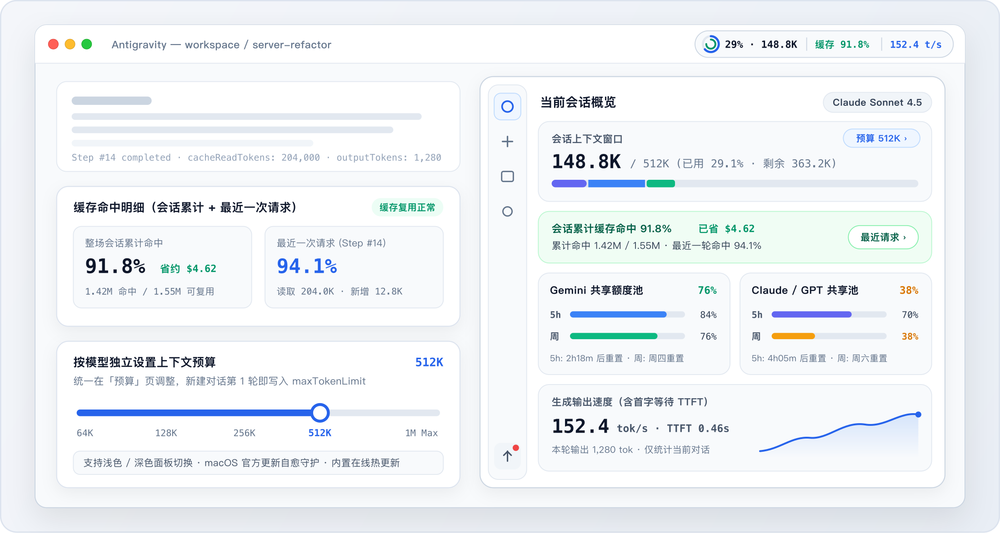

# Antigravity Viewer Pulse

给 Antigravity 桌面端补一个顶栏状态胶囊和用量面板。平时写代码或长对话时，抬头就能看一眼当前上下文用了多少、缓存有没有命中、5 小时和每周额度还剩多少，点开可以按模型单独调上下文上限。



## 主要改了什么

基于 `elviscjn-cjn/antigravity-context-viewer` 做了界面重排和几处日常使用里的痛点修复（兼容 Antigravity `2.32+`，面板内支持浅色 / 深色主题切换）：

- **缓存命中率（会话累计 + 最近一轮）**：主面板默认显示整场对话的累计命中率和估算省下的费用，点右侧「最近请求」能看刚刚那一轮的缓存读取量；如果中途突然掉缓存也会直接提醒。
- **5 小时 + 周额度一起显示**：共享额度池不再只显示 5 小时窗口，把 7 天周限额和各自的重置时间也并排画出来了，避免 5 小时看着还有余量、结果周额度先见底。
- **修正 `tok/s` 速度虚高**：把首字等待时间（TTFT）和流式输出耗时合在一起算端到端速度，修掉了思考模型（Thinking）漏算思考耗时、动辄显示上千 `tok/s` 的问题；切到新对话时也会正常归零，不再串旧会话的数据。
- **去掉冲突的快捷档位**：把首页上容易跟预算设置打架的 `256K / 512K / Max` 重复按钮拿掉了，上下文上限统一在「预算」页按模型保存，新建对话第一轮就会写入生效。
- **客户端更新后自动补回（macOS）**：macOS 安装时会顺带挂一个 `launchd` 文件变动监听（平时不常驻内存），官方客户端自动升级覆盖 `app.asar` 后会自动重新注入，不用每次客户端更新完再手动跑一遍脚本。

## 安装方法

在仓库右侧 **Releases** 下载对应系统的压缩包解压，或者直接 `git clone` 下来：

```bash
git clone https://github.com/DDG0808/antigravity-viewer-pulse.git
cd antigravity-viewer-pulse
```

**macOS**
双击目录里的 `安装 Antigravity Pulse.command`，装完重启一次 Antigravity 即可。
如果从浏览器下载的压缩包第一次打开被系统拦截，在终端进到解压目录执行一次：

```bash
chmod +x install.sh "安装 Antigravity Pulse.command" && ./install.sh
```

**Windows**
先退出正在运行的 Antigravity，再双击 `install.bat`（如果客户端装在 `C:\Program Files` 下提示权限不足，右键选「以管理员身份运行」）。电脑没装 Node.js 也能用，脚本会自动借用客户端自带的运行时完成安装。

**Linux**

```bash
chmod +x install.sh && ./install.sh
```

## 在线更新与卸载

- **在线热更新**：点开顶栏胶囊，切到左下角的「版本更新」页，点「立即检查」即可拉取最新 Release，校验完 `checksums.txt`（SHA-256）后直接热替换核心脚本，一般不用重启客户端。
- **卸载还原**：安装时会自动备份原始 `app.asar`。需要卸载时，macOS 双击 `卸载 Antigravity Pulse.command`（或执行 `./uninstall.sh`），Windows 双击 `uninstall.bat`，Linux 运行 `node cli.js teardown`，即可还原回官方原版文件。

## 常见问题

**macOS 提示“Antigravity 已损坏，无法打开”**
修改包内容后如果触发了系统的隔离属性，重新跑一次 `./install.sh`，或者在终端执行下面两行重签一下即可：

```bash
xattr -cr /Applications/Antigravity.app
codesign --force --deep --sign - /Applications/Antigravity.app
```

**为什么新开对话第一句「缓存命中率」显示 `--`？**
第一轮对话还在建缓存，还没有历史缓存可读，从同一对话的第二轮开始就会正常显示命中率。

**跑 `npm run live` 报错“未检测到运行中的 Antigravity 主窗口”？**
`live` 是改前端样式时用的调试命令，要求客户端带调试端口启动；日常使用直接按上面的步骤正式安装就行。

## 开发与发版说明

常用命令：

```bash
npm run build:renderer                  # 修改 src/renderer/* 后重新生成 meter-renderer.js
node scripts/check-release-manifest.js  # 检查版本号同步与热更新文件清单
npm test                                # 运行测试
node cli.js status                      # 查看当前注入与守护状态
```

如果你 Fork 后想自己发版：同步改好 `package.json`、`plugin.json`、`src/renderer/main.js` 三处的版本号，执行 `npm run build:renderer` 并更新 `RELEASE_NOTES.md`，推送 `v*` 标签（例如 `git tag v0.9.1 && git push origin main --tags`），GitHub Actions 会自动编译打包 6 个平台的压缩包与 `checksums.txt` 并发布 Release。

## 致谢与协议

基于 [MIT License](./LICENSE) 开源。底层 `asar` 注入与采集逻辑基于 `elviscjn-cjn/antigravity-context-viewer` 修改完善，感谢原作者与社区贡献者。

本开源项目已链接并认可 [LINUX DO](https://linux.do/) 社区
