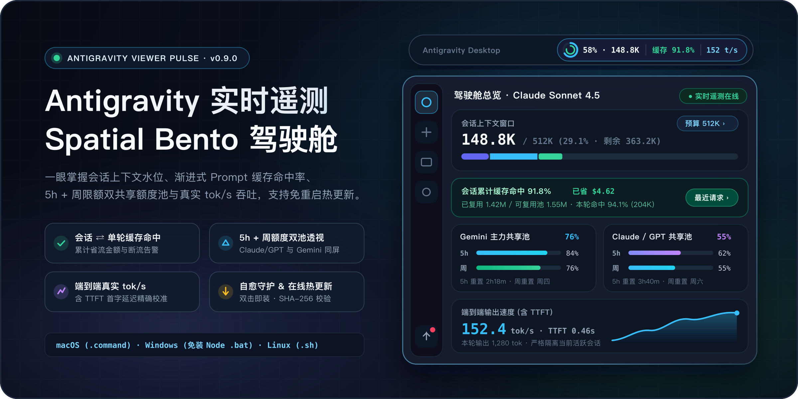
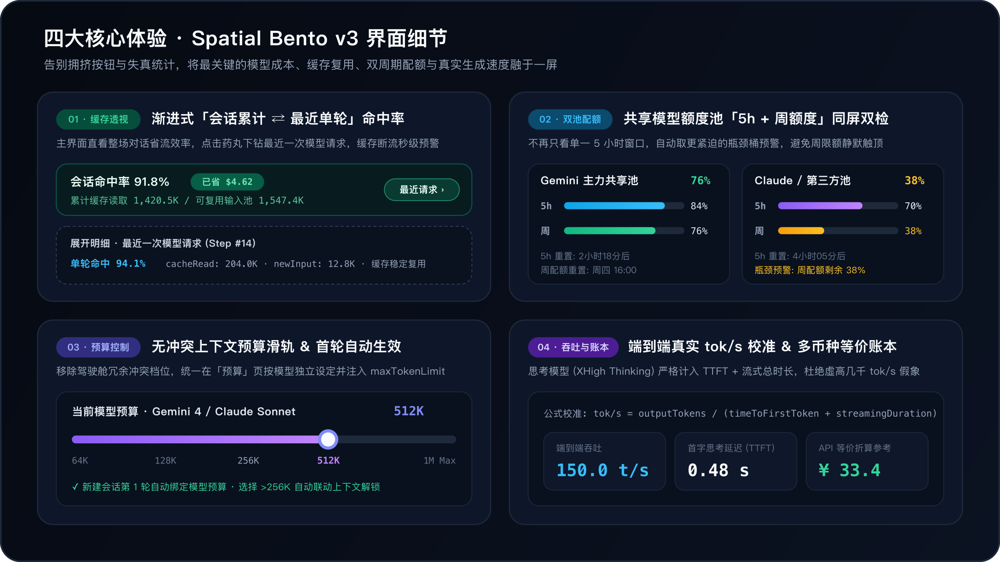
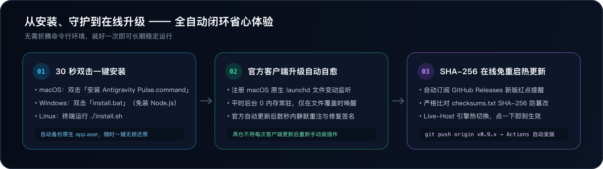

# Antigravity Viewer Pulse

**专为 Antigravity Desktop 打造的 Spatial Bento 实时遥测仪表盘** —— 一眼掌握会话上下文水位、渐进式 Prompt 缓存命中率、`5h + 周额度` 双共享池余量与真实 `tok/s` 输出吞吐，内置官方客户端更新自愈守护与免重启在线热更新。



- **开源仓库**：[DDG0808/antigravity-viewer-pulse](https://github.com/DDG0808/antigravity-viewer-pulse)
- **开源协议**：[MIT License](./LICENSE)
- **版本发布说明**：[RELEASE_NOTES.md](./RELEASE_NOTES.md)

## 核心功能亮点



- **渐进式 Prompt 缓存命中率监控**：主卡片默认显示**整个会话累计命中率**（已命中缓存 / 可复用输入池），直观衡量长对话省流效率；鼠标悬停或点击右侧「查看最近请求」药丸，无缝展开**最近一次模型请求**的精确命中率与 Token 明细。
- **`5h 窗口 + 周限额` 双共享额度池同屏显示**：自动聚合 **Claude / GPT 共享池** 与 **Gemini Pro / Gemini Flash 池**，同时展示 5 小时滚动窗口与 7 天周额度剩余百分比及重置倒计时。
- **端到端 `tok/s` 真实生成速度校准**：全链路追踪模型输出 Token 与流式/非流式生成耗时，区分最近单轮生成速度与会话平均吞吐。
- **清爽无冲突的 Spatial Bento v3 界面**：去除重复冗余的上下文档位按钮，统一在「设置」中管理上下文预算，兼容 Antigravity `2.32+` 最新协议。
- **客户端升级自动自愈（macOS）**：安装后自动配置轻量级 `launchd` 文件变动监听，即使 Antigravity 官方客户端自动升级覆盖了内部文件，也会在几秒内静默恢复插件，无需手动重装。
- **内置 SHA-256 在线免重启热更新**：控制舱「版本更新」页直连 GitHub Releases，新版本亮起红点提醒，一键完成 SHA-256 校验与 Live-Host 热切换。

## 30 秒傻瓜式安装指南



在 [DDG0808/antigravity-viewer-pulse](https://github.com/DDG0808/antigravity-viewer-pulse) 仓库右侧 **Releases** 栏下载对应系统的压缩包并解压，或者直接使用 Git 拉取源码：

```bash
git clone https://github.com/DDG0808/antigravity-viewer-pulse.git
cd antigravity-viewer-pulse
```

### 1. macOS 用户（双击即装）

1. 打开解压后的文件夹，双击 **`安装 Antigravity Pulse.command`**。
   - 若首次从浏览器下载压缩包遇到系统安全拦截，可在终端进入解压目录执行一次：
     ```bash
     chmod +x install.sh "安装 Antigravity Pulse.command" && ./install.sh
     ```
2. 安装器会自动备份原始 `app.asar`、注入插件、修复本地签名，并注册**官方升级自愈守护**。
3. **重启一次 Antigravity**，右上角标题栏即会出现实时上下文胶囊，点击胶囊即可展开完整监控抽屉。

### 2. Windows 用户（免装 Node.js，双击即装）

1. 先完全关闭正在运行的 Antigravity。
2. 双击文件夹内的 **`install.bat`**（若客户端安装在系统保护目录提示权限不足，右键点击选择「以管理员身份运行」）。
   - 即使电脑未安装 Node.js，`install.bat` 也会自动调用 Antigravity 内置运行时完成安装。
3. 重新打开 Antigravity 即可看到右上角监控胶囊。

### 3. Linux 用户

```bash
chmod +x install.sh
./install.sh
```

## 在线热更新与版本发布对接说明

### 普通用户如何在线升级
1. 点击 Antigravity 右上角状态胶囊打开监控抽屉，切换到顶部 **「版本更新」** 标签页（检测到新版本时会自动亮起红点）。
2. 点击 **「立即检查」** 查看最新版本号与更新说明。
3. 点击 **「免重启热更新」**：插件会自动从 `DDG0808/antigravity-viewer-pulse` Releases 下载对应平台压缩包，完成 **SHA-256 完整性校验** 后热替换核心脚本，无需重启客户端即可生效。

### 维护者如何发布新版本（自动对接客户端在线更新）
本仓库已配置 GitHub Actions 全自动发版流水线（`.github/workflows/release.yml`）：

1. 修改代码后，将新版本号（例如 `0.9.1`）同步更新到以下 3 个文件：
   - `package.json` 的 `"version"`
   - `plugin.json` 的 `"version"`
   - `src/renderer/main.js` 的 `METER_VERSION`
2. 构建单文件渲染产物并执行发版前校验：
   ```bash
   npm run build:renderer
   node scripts/check-release-manifest.js
   npm test
   ```
3. 在 `RELEASE_NOTES.md` 中编写本次更新日志（客户端「版本更新」页会直接读取并展示）。
4. 推送 `v*` 标签，GitHub Actions 会自动编译 Windows 辅助组件、打包 6 大平台架构的 `antigravity-viewer-pulse_<ver>_<os>_<arch>.zip`、生成 `checksums.txt` 并发布正式 GitHub Release：
   ```bash
   git add -A
   git commit -m "chore(release): v0.9.1"
   git tag v0.9.1
   git push origin main --tags
   ```
   也可以在仓库页面的 **Actions -> Release Antigravity Viewer Pulse** 手动点击 `Run workflow` 触发发布。

## 一键干净卸载与恢复原生

安装时创建的 `.backup` 原始备份随时可以一键无损还原：

- **macOS**：双击 **`卸载 Antigravity Pulse.command`**，或在终端执行 `./uninstall.sh`（同时清理 `~/.antigravity-pulse` 与 `launchd` 守护）。
- **Windows**：双击 **`uninstall.bat`**。
- **Linux / 通用命令行**：执行 `node cli.js teardown`（或 `node cli.js restore`）。

## 常见问题排查 (FAQ)

- **macOS 客户端提示“已损坏，无法打开”怎么办？**
  运行一次 `./install.sh` 自动修复本地签名，或在终端执行：
  ```bash
  xattr -cr /Applications/Antigravity.app
  codesign --force --deep --sign - /Applications/Antigravity.app
  ```
- **为什么新会话第一轮对话时「缓存命中率」显示 `--` 或 `暂无复用`？**
  首轮对话仍在建立初始上下文缓存，尚未发生历史缓存读取；从同一会话第 2 轮对话起即可展示实时累计命中率，悬停或点击药丸可展开查看最近一次模型请求的精确命中率。
- **执行开发调试命令 `npm run live` 提示“未检测到运行中的 Antigravity 主窗口”？**
  `live` 模式仅面向开发者在开启调试端口时免打包预览；日常使用请直接运行 `./install.sh` 或双击安装脚本完成正式注入，之后正常点击图标启动 Antigravity 即可长期生效。

## 常用命令速查

| 命令 | 说明 |
| :--- | :--- |
| `node cli.js setup` | 正式安装插件（macOS 下含 `~/.antigravity-pulse` 托管与更新自愈守护） |
| `node cli.js status` | 查看当前注入状态、备份完整性与自愈守护运行情况 |
| `node cli.js teardown` | 卸载插件、清理守护任务并恢复官方原生 `app.asar` |
| `npm run build:renderer` | 将 `src/renderer/*` 重新构建为 `meter-renderer.js` |
| `npm test` | 运行遥测精度、双池额度、在线热更新与隐私安全自动化测试 |

## 开源协议与致谢

本项目基于 [MIT License](./LICENSE) 开源。底层 `asar` 注入与遥测采集架构部分参考并致谢上游开源项目 `elviscjn-cjn/antigravity-context-viewer`，在此基础上重构了 Spatial Bento v3 界面、渐进式会话/单轮缓存命中率交互、`5h + 周额度` 双池透视、端到端 `tok/s` 校准以及 macOS 官方更新自愈守护体系。

本开源项目已链接并认可 [LINUX DO](https://linux.do/) 社区

